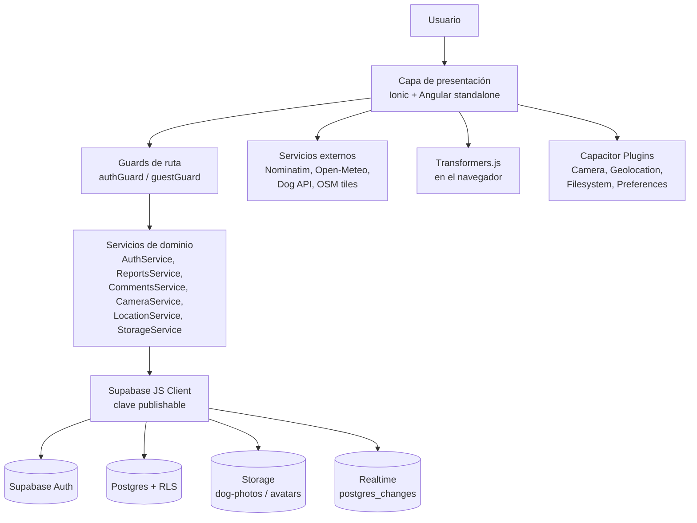
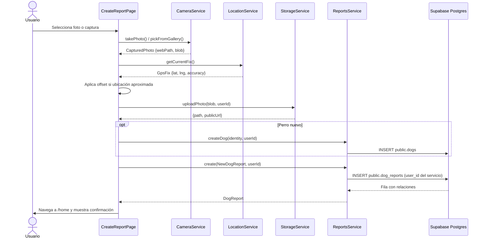
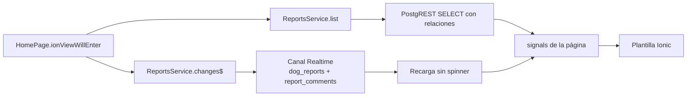
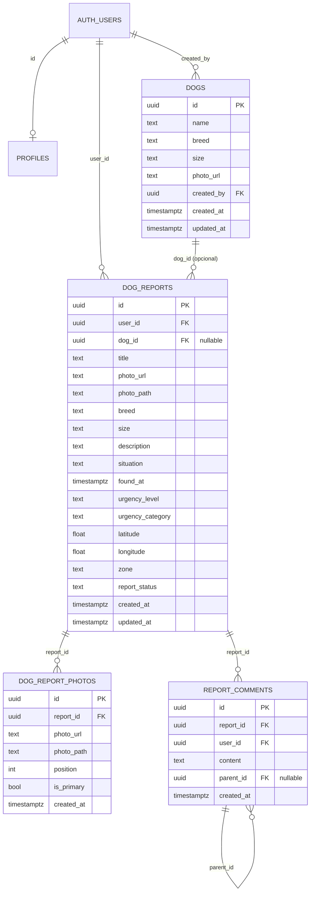
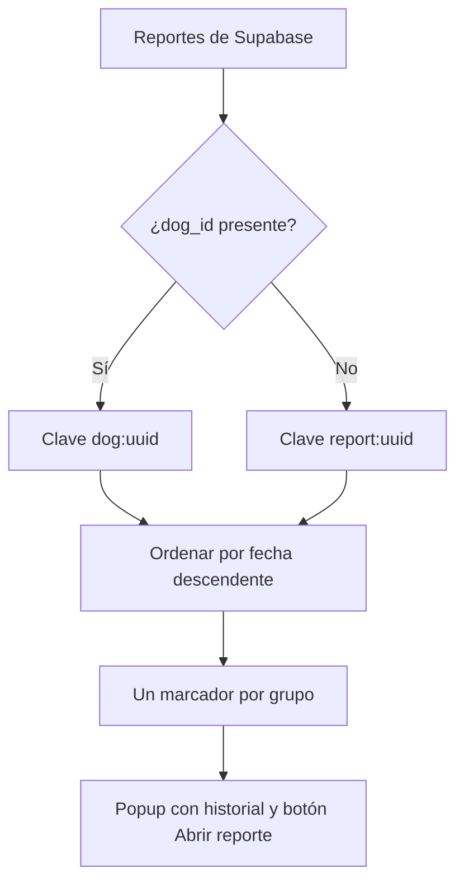
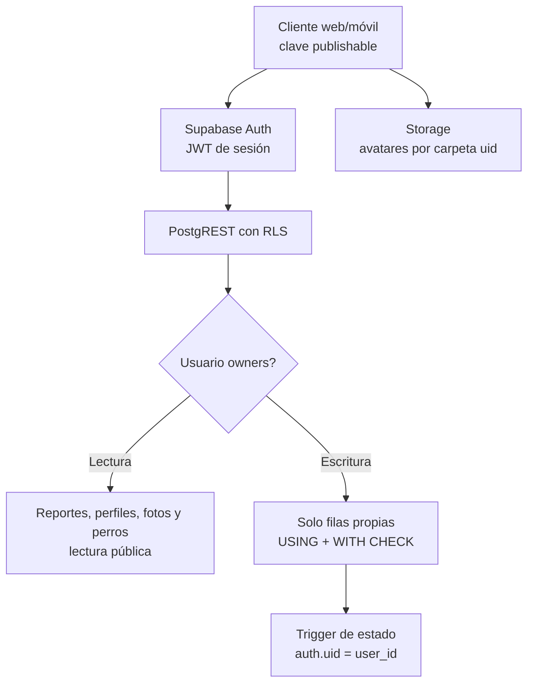

# Documentación técnica y guía de exposición académica — PAWNDER

> Documento elaborado exclusivamente a partir de la lectura del repositorio `C:\Users\Maria Angel\Desktop\finalproject\Pawnder`.
> No modifica código, configuración, dependencias ni migraciones. No expone claves secretas completas.
> Fecha del análisis: 2026-11-24.

## Convenciones

| Etiqueta | Significado |
|---|---|
| **Implementado** | Existe código real en el repositorio y se puede seguir su recorrido. |
| **Parcial** | Existe parte del código o de la infraestructura, pero falta algo para considerarlo completo. |
| **No implementado** | No aparece en el código revisado. |
| **No verificado en ejecución** | El código existe, pero el análisis estático no permite comprobar su comportamiento real en Supabase o en un dispositivo. |

Las rutas se indican relativas a la raíz de `Pawnder/`. Los fragmentos de código son transcripciones literales de los archivos citados.

---

# CAPÍTULO 1. PRESENTACIÓN GENERAL DEL PROYECTO

## 1.1 Qué es PAWNDER

PAWNDER es una aplicación híbrida (web + móvil mediante Capacitor) para reportar perros encontrados, perdidos o en situación de riesgo. El usuario autenticado puede crear un aviso con foto, cámara o galería, GPS, raza, tamaño, descripción, urgencia y clima; la comunidad puede explorar los avisos en un listado filtrable y en un mapa, comentar, responder y coordinar ayuda. El autor de cada aviso puede editarlo, eliminarlo y actualizar su estado de seguimiento.

El título y el lema se encuentran en `src/index.html`: **PAWNDER — Cada huella cuenta**. El color principal de la interfaz es verde menta (`#10b981`) definido en `src/global.scss`. El identificador de aplicación en `capacitor.config.ts` es `com.awnder.app` y el directorio web es `www`.

## 1.2 Datos de identificación del repositorio

| Concepto | Valor real |
|---|---|
| Nombre del paquete | `Pawnder` |
| Versión | `0.0.1` |
| Tipo | Proyecto privado Ionic/Angular standalone |
| Gestor de dependencias | npm (`package.json`, `package-lock.json`) |
| Cliente de backend | Supabase (Auth, Postgres, Storage, Realtime) |
| Plataforma móvil | Capacitor con carpeta `android/`; no hay carpeta `ios/` en el repositorio |

## 1.3 Estructura de carpetas observada

```
Pawnder/
├── android/                     # Proyecto nativo Android generado por Capacitor
├── e2e/                         # Prueba end-to-end con Playwright
├── src/
│   ├── app/
│   │   ├── app.component.ts
│   │   ├── app.routes.ts
│   │   ├── core/
│   │   │   ├── guards/          # authGuard y guestGuard
│   │   │   ├── services/        # Supabase, Auth, Reports, Comments, Camera, Location,
│   │   │   │                    # Storage, Breeds, Geocoding, Weather, DogVision, Ui, Prefs
│   │   │   └── utils/           # report-groups.ts, hardware-error.ts, http-error.ts
│   │   ├── models/              # dog-report.model.ts, user.model.ts, comment.model.ts, breed.model.ts
│   │   ├── pages/               # splash, main-menu, login, register, home, map-view,
│   │   │                        # report-detail, create-report, edit-report, profile, tabs
│   │   └── shared/components/   # city-map, mini-map, camera-capture, photo-carousel,
│   │                            # weather-indicator, loading, dog-avatar, etc.
│   ├── environments/
│   ├── global.scss
│   ├── index.html
│   └── main.ts
├── supabase/migrations/         # Dos migraciones SQL versionadas
├── capacitor.config.ts
├── angular.json
└── package.json
```

La carpeta `src/app/pages/tabs/tabs.page.ts` existe, pero **no está registrada en `app.routes.ts`**; por tanto no forma parte del recorrido navegable actual.

---

# CAPÍTULO 2. OBJETIVOS, ALCANCE Y JUSTIFICACIÓN

## 2.1 Objetivo general

Diseñar e implementar una aplicación que permita documentar avistamientos de perros con datos verificables (fotografía, coordenadas, fecha, urgencia y clima), centralizarlos en una base de datos compartida y mostrarlos en un mapa colaborativo, con reglas claras de autoría sobre la información publicada.

## 2.2 Objetivos específicos comprobables en código

| Objetivo | Evidencia en el repositorio | Estado |
|---|---|---|
| Registro e inicio de sesión con correo y contraseña | `AuthService.register`, `AuthService.login` sobre `supabase.auth` | Implementado |
| Publicación de avisos con foto y GPS | `create-report.page.ts` + `CameraService` + `LocationService` + `StorageService` | Implementado |
| Listado con filtros de zona, raza y urgencia | `ReportsService.list` y `home.page.ts` | Implementado |
| Mapa con agrupación por perro | `groupReportsByDog` y `city-map.component.ts` | Implementado |
| Identidad explícita del perro | Tabla `public.dogs` y columna `dog_reports.dog_id` | Implementado (migración ejecutada por el propietario del proyecto) |
| Cambio de estado restringido al autor | Trigger `dog_reports_status_owner_guard()` | Implementado en SQL; **no verificado con dos cuentas reales** |
| Comentarios y respuestas en árbol | `report_comments.parent_id`, `CommentsService`, UI en `report-detail.page.ts` | Implementado; aplicación de la migración social **no confirmada en ejecución** |
| Sugerencia automática de raza a partir de imagen | `DogVisionService` con modelos del navegador | Implementado; depende de descarga/caché del navegador |
| Recuperación de contraseña | Sin método `resetPasswordForEmail` en el código revisado | No implementado |

## 2.3 Justificación de decisiones de diseño

1. **Backend gestionado.** Se delega autenticación, base de datos, almacenamiento y suscripciones en Supabase, evitando desplegar un servidor propio. El cliente se inicializa con la clave *publishable* (pública) en `src/environments/environment.ts`; la clave secreta `service_role` no aparece en el repositorio.
2. **Agrupación por identidad, no por proximidad.** Agrupar por GPS, fotos o similitud de texto uniría perros distintos que estuvieron cerca o que se parecen. El sistema introduce `public.dogs` y una relación opcional `dog_id`. El comentario en `src/app/core/utils/report-groups.ts` lo expresa literalmente: *"Nunca se agrupan por GPS"*.
3. **Autoría como eje de seguridad.** Las operaciones de escritura sobre reportes, fotos, perfiles y perros se restringen al usuario creador mediante políticas RLS y, en el caso del estado, mediante un trigger que impide además cambiar `user_id`.
4. **Privacidad de la ubicación.** El formulario permite marcar la ubicación como aproximada y, en ese caso, desplaza las coordenadas antes de guardarlas. Es una medida deliberada pero de precisión limitada (ver capítulo 8).
5. **Arquitectura standalone y cargas diferidas.** `main.ts` usa `bootstrapApplication` y `provideRouter` con `PreloadAllModules`; cada página se carga con `loadComponent`, lo que reduce el paquete inicial.

---

# CAPÍTULO 3. MARCO TECNOLÓGICO Y SERVICIOS EXTERNOS

## 3.1 Dependencias declaradas en `package.json`

| Paquete | Versión declarada | Función en el proyecto |
|---|---|---|
| `@angular/core`, `@angular/common`, `@angular/router`, `@angular/forms` | `22.2.5` | Núcleo de la SPA, enrutado y formularios |
| `@ionic/angular` | `^9.0.0` | Componentes de interfaz móvil (`ion-*`) |
| `@capacitor/core` | `8.6.2` | Puente web/nativo |
| `@capacitor/android` | `^8.6.2` | Plataforma Android |
| `@capacitor/camera` | `^8.2.6` | Cámara y galería |
| `@capacitor/geolocation` | `^8.2.4` | GPS del dispositivo |
| `@capacitor/preferences` | `^8.0.1` | Borrador local del formulario |
| `@capacitor/filesystem` | `^8.1.5` | Lectura del archivo capturado |
| `@supabase/supabase-js` | `^2.119.0` | Auth, PostgREST, Storage y Realtime |
| `leaflet` | `^1.9.4` | Mapa interactivo |
| `leaflet.markercluster` | `^1.5.3` | Agrupación visual de marcadores |
| `@huggingface/transformers` | `^4.3.2` | Inferencia de visión en el navegador |
| `rxjs` | `~7.8.0` | Observables y señales reactivas complementarias |
| `typescript` (dev) | `~6.0.0` | Tipado estático |
| `vitest` (dev) | `^5.1.0` | Pruebas unitarias |
| `@playwright/test` (dev) | `^1.64.1` | Prueba end-to-end |

## 3.2 Configuración de arranque

`src/main.ts` registra el enrutador con precarga y enlace de parámetros de entrada:

```ts
bootstrapApplication(AppComponent, {
  providers: [
    { provide: RouteReuseStrategy, useClass: IonicRouteStrategy },
    provideIonicAngular(),
    provideHttpClient(),
    provideRouter(routes, withPreloading(PreloadAllModules), withComponentInputBinding()),
  ],
});
```

## 3.3 Cliente de Supabase

`src/app/core/services/supabase.service.ts`:

```ts
readonly client: SupabaseClient = createClient(
  environment.supabaseUrl,
  environment.supabaseAnonKey,
  {
    auth: {
      persistSession: true,
      autoRefreshToken: true,
      detectSessionInUrl: false,
    },
  }
);
```

`src/environments/environment.ts` contiene la URL del proyecto, la clave **publishable** (omitida aquí deliberadamente), el bucket `dog-photos` y el bucket `avatars`. Al usar solo la clave pública, cualquier límite de acceso depende de RLS; no existe una clave de administrador en el cliente.

## 3.4 Servicios externos consumidos

| Servicio | URL / identificador observado | Uso real | Archivo |
|---|---|---|---|
| Supabase | `https://jvxhggxdwcrhgkjuvxjk.supabase.co` | Auth, tablas, Storage y Realtime | `environment.ts` |
| Nominatim (OpenStreetMap) | `https://nominatim.openstreetmap.org/reverse` | Geocodificación inversa de coordenadas | `geocoding.service.ts` |
| Open-Meteo | `https://api.open-meteo.com/v1/forecast` | Temperatura, humedad, precipitación, viento y código de clima | `weather.service.ts` |
| Dog API | `https://dogapi.dog/api/v2/breeds?page[number]=N` | Catálogo de razas (solo texto, no imágenes de perro) | `breeds.service.ts` |
| OSM Tile Server | `https://tile.openstreetmap.org/{z}/{x}/{y}.png` | Mosaicos base del mapa | `city-map.component.ts` / `map.service.ts` |
| Hugging Face models | `Xenova/detr-resnet-50`, `Xenova/fastvit_t12.apple_dist_in1k` | Detección de perro y clasificación de imagen en el navegador | `dog-vision.service.ts` |
| Google Maps | `https://www.google.com/maps/search/?api=1&query=...` | Enlace externo para navegar hasta la coordenada | `report-detail.page.ts` |

### 3.4.1 Geocodificación inversa

`geocoding.service.ts` construye parámetros `format=jsonv2`, `lat`, `lon`, `zoom=18`, `addressdetails=1` y `accept-language=es`, y devuelve `null` cuando falla la petición:

```ts
const params = new HttpParams()
  .set('format', 'jsonv2')
  .set('lat', latitude.toFixed(6))
  .set('lon', longitude.toFixed(6))
  .set('zoom', '18')
  .set('addressdetails', '1')
  .set('accept-language', 'es');
```

### 3.4.2 Clima

`weather.service.ts` solicita `current=temperature_2m,relative_humidity_2m,precipitation,weather_code,wind_speed_10m` con `timezone=auto` y convierte el código de clima en etiqueta y emoji mediante `interpretWeather`.

### 3.4.3 Catálogo de razas

`BreedsService.getBreeds()` recorre páginas hasta `maxPages = 15` usando el operador `expand` de RxJS y guarda el resultado en `cache$`. Añade dos opciones propias: `Mestizo` y `Raza desconocida`. El catálogo es un complemento textual: la sugerencia visual proviene de los modelos de visión, no de una API especializada en razas.

### 3.4.4 Visión por computador

`dog-vision.service.ts` importa dinámicamente `@huggingface/transformers`, fija `env.allowLocalModels = false` y usa dos etapas:

- `Xenova/detr-resnet-50` para localizar un perro dentro de la imagen.
- `Xenova/fastvit_t12.apple_dist_in1k` para clasificar la imagen o el recorte.
- `matchBreed(label, breeds)` compara las etiquetas del modelo con los nombres del catálogo de Dog API.

Es una **sugerencia orientativa**, no un modelo entrenado para razas caninas. Si no hay perro con confianza suficiente, el servicio marca el caso como no-perro. La disponibilidad sin conexión depende de la caché del navegador.

---

# CAPÍTULO 4. ARQUITECTURA GENERAL

## 4.1 Vista por capas



## 4.2 Módulos y responsabilidades

| Capa | Archivos representativos | Responsabilidad |
|---|---|---|
| Arranque | `src/main.ts`, `src/app/app.component.ts` | Bootstrap, proveedores globales, enrutado |
| Rutas | `src/app/app.routes.ts`, `src/app/core/guards/auth.guard.ts` | Navegación diferida y control de acceso |
| Páginas | `src/app/pages/**` | Flujos de usuario y estado local con `signal()` |
| Servicios | `src/app/core/services/**` | Comunicación con Supabase y hardware |
| Utilidades | `src/app/core/utils/report-groups.ts` | Reglas puras de agrupación y escape HTML |
| Modelos | `src/app/models/**` | Tipos TypeScript y opciones de formulario |
| Componentes compartidos | `src/app/shared/components/**` | Mapa, carrusel, cámara, clima, avatar |
| Persistencia | `supabase/migrations/**` | DDL, RLS, trigger y publicación Realtime |

## 4.3 Flujo de una publicación



## 4.4 Flujo de lectura y actualización en tiempo real



`ReportsService.changes$()` crea un canal con nombre aleatorio y se suscribe a dos tablas:

```ts
const channel = this.supabase
  .channel(`reports-${Math.random().toString(36).slice(2)}`)
  .on('postgres_changes', { event: '*', schema: 'public', table: 'dog_reports' }, () => subscriber.next())
  .on('postgres_changes', { event: '*', schema: 'public', table: 'report_comments' }, () => subscriber.next())
  .subscribe();
return () => { this.supabase.removeChannel(channel); };
```

La página de detalle usa además `CommentsService.changesForReport$(reportId)` con filtro `report_id=eq.${reportId}`. **La vista `map-view` no se suscribe a Realtime**: recarga los datos al entrar y mediante el botón de refresco manual.

---

# CAPÍTULO 5. MODELO DE DATOS Y PERSISTENCIA

## 5.1 Tablas de la aplicación

Se identifican cinco tablas en `public`: `profiles`, `dog_reports`, `dog_report_photos`, `report_comments` y `dogs`. El DDL base de `profiles`, `dog_reports` y `report_comments` **no está versionado en el repositorio**; su estructura se infiere de los `select` de los servicios, de los tipos TypeScript y de las columnas que las migraciones modifican.



## 5.2 Entidad `dogs` e identidad explícita

`supabase/migrations/20261124_dog_identity_and_status.sql` crea la tabla de forma idempotente:

```sql
CREATE TABLE IF NOT EXISTS public.dogs (
  id uuid PRIMARY KEY DEFAULT gen_random_uuid(),
  name text,
  breed text,
  size text,
  photo_url text,
  created_by uuid NOT NULL REFERENCES auth.users(id) ON DELETE CASCADE,
  created_at timestamptz NOT NULL DEFAULT now(),
  updated_at timestamptz NOT NULL DEFAULT now()
);
```

La migración añade `dog_id` a `dog_reports` solo si no existe, crea la restricción foránea con `ON DELETE SET NULL` y un índice:

```sql
ALTER TABLE public.dog_reports ADD COLUMN dog_id uuid NULL;
ALTER TABLE public.dog_reports
  ADD CONSTRAINT dog_reports_dog_id_fkey
  FOREIGN KEY (dog_id) REFERENCES public.dogs(id) ON DELETE SET NULL;
CREATE INDEX IF NOT EXISTS dog_reports_dog_id_idx ON public.dog_reports (dog_id);
```

**Los reportes anteriores quedan con `dog_id = NULL`.** La migración no hace *backfill* porque no existe una regla fiable para inferir identidad. El propietario del proyecto ejecutó esta migración y confirmó que la tabla `dogs` estaba vacía y que los reportes antiguos conservaban `dog_id` nulo.

## 5.3 Modelo TypeScript principal

`src/app/models/dog-report.model.ts` define los tipos que viajan entre la UI y Supabase:

```ts
export type DogSize = 'pequeno' | 'mediano' | 'grande';
export type UrgencyLevel = 'normal' | 'alta' | 'critica';
export type UrgencyCategory = 'herido' | 'enfermo' | 'embarazada' | 'cachorros' | 'atrapado' | 'clima_adverso' | 'otro';
export type ReportStatus = 'activo' | 'en_proceso' | 'resuelto';
```

Sobre `DogReport` hay una advertencia literal en el archivo:

```ts
// Notas de UI/legacy: NO existen en public.dog_reports y nunca se envían a Supabase.
// La urgencia se deriva de urgency_level !== 'normal' y la privacidad se aplica
// difuminando las coordenadas antes de guardar el reporte.
is_approximate_location?: boolean;
is_emergency?: boolean;
```

`NewDogReport` excluye `id`, `user_id`, fechas, relaciones y esos dos campos de UI. `ReportPatch` es un `Partial<Pick<...>>` que incluye `report_status`, entre otros campos.

## 5.4 Consultas con relaciones

`ReportsService` usa una única cadena de selección para todas sus lecturas:

```ts
const SELECT =
  '*, profiles(display_name, avatar_url), dogs(id, name, breed, size, photo_url, created_at), dog_report_photos(id, report_id, photo_url, photo_path, position, is_primary), report_comments(count)';
```

**Observación de integración no verificada:** el servicio solicita la relación `dog_report_photos(...)`, pero los modelos y componentes leen `report.photos`. No se encontró en el código revisado un alias o mapping que convierta `dog_report_photos` en `photos`. La migración social añade la tabla y su backfill; el comportamiento real depende de que la migración esté aplicada y de la forma en que PostgREST devuelva la relación. Por esto se clasifica como **no verificado en ejecución**.

## 5.5 Migraciones versionadas

| Archivo | Contenido principal |
|---|---|
| `supabase/migrations/20261123_social_features.sql` | `avatar_url` y `bio` en perfiles; `parent_id` en comentarios; tabla `dog_report_photos`; backfill de la foto principal; bucket `avatars`; políticas RLS; Realtime para fotos |
| `supabase/migrations/20261124_dog_identity_and_status.sql` | Tabla `dogs`; columna `dog_id`; políticas RLS de `dogs`; función y trigger de estado; Realtime para `dogs` |

Ambas son idempotentes: usan `IF NOT EXISTS`, `CREATE OR REPLACE`, `DROP POLICY IF EXISTS` y bloques `DO $$ ... $$`. La segunda indica explícitamente que debe ejecutarse después de la primera.

### 5.5.1 Backfill de fotografías

La migración social copia la foto principal antigua a la nueva tabla solo si el reporte aún no tiene filas:

```sql
INSERT INTO public.dog_report_photos (report_id, photo_url, photo_path, position, is_primary)
SELECT dr.id, dr.photo_url, dr.photo_path, 0, true
FROM public.dog_reports AS dr
WHERE dr.photo_url IS NOT NULL
  AND btrim(dr.photo_url) <> ''
  AND NOT EXISTS (
    SELECT 1 FROM public.dog_report_photos AS p WHERE p.report_id = dr.id
  );
```

### 5.5.2 Políticas y objetos de base de datos

Las dos migraciones definen **26 políticas RLS**, **una función** y **un trigger**:

- `profiles`: 2 políticas de actualización (permisiva y restrictiva).
- `dog_reports`: 4 políticas de actualización y borrado (permisivas y restrictivas).
- `dog_report_photos`: 7 políticas (lectura pública + inserción, actualización y borrado del autor + tres salvaguardas restrictivas).
- `report_comments`: 2 políticas de borrado.
- `dogs`: 7 políticas (lectura pública + inserción, actualización y borrado del creador + tres salvaguardas restrictivas).
- `storage.objects` para `avatars`: 4 políticas de lectura pública y escritura por carpeta de usuario.
- Función `public.dog_reports_status_owner_guard()` y trigger `BEFORE UPDATE OF report_status, user_id`.

**No hay políticas versionadas para el bucket `dog-photos` en estas dos migraciones**; solo para `avatars`. El comportamiento de subida de fotos de reportes depende de configuración previa no incluida en el repositorio.

---

# CAPÍTULO 6. DISEÑO DE INTERFACES Y NAVEGACIÓN

## 6.1 Rutas reales

`src/app/app.routes.ts` declara:

| Ruta | Guardia | Página | Observación |
|---|---|---|---|
| `''` | — | Redirige a `splash` | `pathMatch: 'full'` |
| `splash` | — | `SplashPage` | Portada |
| `menu` | — | `MainMenuPage` | Menú principal |
| `login` | `guestGuard` | `LoginPage` | Usuario con sesión vuelve a `/home` |
| `register` | `guestGuard` | `RegisterPage` | Usuario con sesión vuelve a `/home` |
| `home` | — | `HomePage` | Listado público con filtros |
| `map-view` | — | `MapViewPage` | Mapa público |
| `report-detail/:id` | — | `ReportDetailPage` | Ficha pública |
| `create-report` | `authGuard` | `CreateReportPage` | Requiere sesión |
| `edit-report/:id` | `authGuard` | `EditReportPage` | Requiere sesión |
| `profile` | `authGuard` | `ProfilePage` | Perfil propio |
| `profile/:userId` | `authGuard` | `ProfilePage` | Perfil de otro usuario autenticado |
| `**` | — | Redirige a `splash` | Ruta comodín |

`authGuard` espera a `AuthService.whenReady()` y devuelve `router.createUrlTree(['/login'])` si no hay sesión. `guestGuard` hace el recorrido inverso hacia `/home`.

## 6.2 Guardas

```ts
export const authGuard: CanActivateFn = async () => {
  const auth = inject(AuthService);
  const router = inject(Router);
  await auth.whenReady();
  return auth.isLoggedIn() ? true : router.createUrlTree(['/login']);
};
```

## 6.3 Flujos principales

### 6.3.1 Registro y sesión

`AuthService.register()` envía `display_name` en `user_metadata` y determina `needsConfirmation` con `data.session === null`. `RegisterPage` muestra un aviso modal si Supabase exige confirmar el correo. `AuthService` mantiene `session`, `profile`, `user`, `isLoggedIn` y `displayName` como señales, escucha `onAuthStateChange` y carga el perfil con `maybeSingle()`. El traductor de errores convierte mensajes de Supabase a español.

**No se encontró** en `register.page.ts` ni en `AuthService` una inserción explícita en `public.profiles` después de `signUp`. Si no existe un trigger en la base de datos fuera del repositorio, el perfil podría no crearse; este punto queda marcado como **no verificado**.

### 6.3.2 Listado y filtros

`HomePage` mantiene `filters` con `DEFAULT_FILTERS` (zona vacía, raza vacía, urgencia `todas`, orden `recientes`). `ReportsService.list()` aplica `eq('urgency_level', ...)`, `ilike('zone', ...)`, `ilike('breed', ...)` y `order('created_at', { ascending: filters?.order === 'antiguos' })`. El propio `HomePage` filtra además en cliente por urgencia y texto.

### 6.3.3 Mapa

`MapViewPage` carga reportes, obtiene la ubicación del usuario con `LocationService` y pasa `[reports]`, `[filter]`, `[userLat]`, `[userLng]` y el evento `(selectReport)` a `CityMapComponent`. La barra de filtros del mapa tiene tres valores: `all`, `alerts` y `community`.

`CityMapComponent` usa Leaflet, `leaflet.markercluster`, un icono de usuario, mosaicos de OpenStreetMap y un popup HTML construido con `escapeHtml`. Su método `recenter(lat, lon)` existe, pero una búsqueda en `src/` muestra **una sola aparición: su propia declaración**; no se invoca desde ninguna plantilla. El botón de recentrar de `map-view.page.ts` llama a `locateMe()` en la página, no a `recenter()`.

### 6.3.4 Ficha de reporte

`ReportDetailPage` muestra carrusel de fotos, clima, mini-mapa, enlace a Google Maps, estado, comentarios en árbol y acciones del autor (editar, eliminar, cambiar estado). `isOwner()` se calcula comparando el usuario actual con `report.user_id`.

### 6.3.5 Perfil

`ProfilePage` usa la ruta con parámetro opcional `userId`; si no hay parámetro, muestra el perfil propio. `AuthService.fetchProfile(userId)` obtiene `display_name`, `avatar_url`, `bio` y `created_at`. `updateProfile()` actualiza el perfil propio con `.eq('id', user.id)`. Los avatares se suben al bucket `avatars`.

---

# CAPÍTULO 7. IMPLEMENTACIÓN DE FUNCIONALIDADES CLAVE

## 7.1 Creación de reporte e identidad del perro

El formulario de `create-report.page.ts` ofrece un selector de modo: perro nuevo o perro ya registrado. `searchDogs()` invoca a `ReportsService.searchDogs(query)`, que baja hasta 100 perros ordenados por `created_at` y filtra **en cliente** por nombre o raza:

```ts
async searchDogs(query: string): Promise<DogIdentity[]> {
  const { data, error } = await this.supabase
    .from('dogs')
    .select('id, name, breed, size, photo_url, created_at')
    .order('created_at', { ascending: false })
    .limit(100);
  if (error) throw new Error(this.msg(error.message));
  const term = query.trim().toLowerCase();
  const dogs = (data ?? []) as DogIdentity[];
  if (!term) return dogs;
  return dogs.filter((dog) => [dog.name, dog.breed].some((value) => value?.toLowerCase().includes(term)));
}
```

El comentario del método es explícito: *"Busca perros ya registrados por nombre o raza. Nunca infiere identidad por fotos/GPS."*

La publicación decide el `dog_id` así:

```ts
let dogId: string | null = null;
if (this.dogMode() === 'new') {
  const dog = await this.reports.createDog(
    { name: this.dogName().trim() || null, breed: this.breed(), size: this.size() as DogSize,
      photo_url: uploaded.publicUrl },
    user.id,
  );
  dogId = dog.id;
  createdDogId = dog.id;
} else if (this.dogMode() === 'existing') {
  dogId = this.selectedDog()?.id ?? null;
}
```

Si falla la publicación, se deshace el perro recién creado (`deleteDog`) y se borra la foto subida (`deletePhoto`). Es una compensación manual, no una transacción de base de datos.

## 7.2 Privacidad aplicada antes del guardado

```ts
let finalLat = gps.latitude;
let finalLng = gps.longitude;
if (this.isApproximateLocation()) {
  const offsetLat = (Math.random() - 0.5) * 0.003;
  const offsetLng = (Math.random() - 0.5) * 0.003;
  finalLat += offsetLat;
  finalLng += offsetLng;
}
```

El comentario del código afirma *"pequeño offset aleatorio (30-80 metros)"*, pero la expresión `/0.003` produce un rango de aproximadamente **±0,0015° en cada eje** (hasta ~167 m en latitud en el ecuador y un valor variable en longitud según la latitud). La cifra del comentario y la magnitud real no coinciden, por lo que el documento reporta el código, no la estimación textual.

## 7.3 Construcción del registro

```ts
const report: NewDogReport = {
  dog_id: dogId,
  title: this.title().trim(),
  photo_url: uploaded.publicUrl,
  photo_path: uploaded.path,
  breed: this.breed(),
  size: this.size() as DogSize,
  description: this.description().trim(),
  situation: situationParts.filter(Boolean).join('\n\n') || null,
  found_at: new Date(this.foundAt()).toISOString(),
  urgency_level: isEm ? this.urgencyLevel() : 'normal',
  urgency_category: isEm ? this.urgencyCategory() || null : null,
  latitude: finalLat,
  longitude: finalLng,
  zone: this.zone().trim(),
  weather_code: w?.weather_code ?? null,
  /* ...resto de campos de clima... */
  report_status: 'activo',
};
await this.reports.create(report, user.id);
```

`ReportsService.create()` añade `user_id` en el servidor, no lo toma del formulario:

```ts
.insert({ ...input, user_id: userId })
.select(SELECT)
.single();
```

El borrador del formulario se guarda en `Capacitor Preferences` mediante `PrefsService` y se elimina con `this.prefs.remove(PREF_KEYS.reportDraft)` tras publicar.

## 7.4 Fotografías

| Operación | Servicio / archivo | Detalle |
|---|---|---|
| Captura con vista previa | `CameraService.takePhoto()` | Abre `CameraCaptureComponent` en un modal; si el rol es `fallback`, usa el plugin nativo |
| Galería | `CameraService.pickFromGallery()` | `CameraSource.Photos` con `webUseInput: true` en navegador |
| Subida | `StorageService.uploadPhoto()` | Ruta `<userId>/<timestamp>-<aleatorio>.<ext>` en bucket `dog-photos` |
| Foto principal inicial | `create-report.page.ts` | Sube **una** foto y la guarda en `dog_reports.photo_url` |
| Múltiples fotos | `ReportsService.listPhotos()` / `syncPhotos()` | Usa `dog_report_photos`, ordena por `position` y mantiene una principal |
| Carrusel | `photo-carousel.component.ts` | Componente de presentación en la ficha y en edición |
| Borrado | `ReportsService.remove()` | Borra el reporte y limpia las rutas de Storage encontradas |

`syncPhotos()` limpia primero `is_primary` para no chocar con el índice único `dog_report_photos_one_primary_per_report_idx`, y calcula una clave por `photo_path` o `photo_url` para decidir altas, bajas y actualizaciones.

**Parcial:** la tabla y la edición soportan varias fotos, pero el flujo inicial de creación publica solo la foto principal.

## 7.5 Agrupación determinista en el mapa

`src/app/core/utils/report-groups.ts` implementa la regla de negocio más importante del proyecto:

```ts
export function groupReportsByDog(reports: DogReport[]): ReportGroup[] {
  const grouped = new Map<string, DogReport[]>();
  for (const report of reports) {
    const key = report.dog_id ? `dog:${report.dog_id}` : `report:${report.id}`;
    const current = grouped.get(key);
    if (current) current.push(report);
    else grouped.set(key, [report]);
  }
  return [...grouped.entries()]
    .map(([key, list]) => {
      const sorted = [...list].sort((a, b) => timeOf(b) - timeOf(a));
      return { key, dogId: sorted[0].dog_id ?? null, reports: sorted, latest: sorted[0] };
    })
    .sort((a, b) => timeOf(b.latest) - timeOf(a.latest));
}
```

Propiedades derivadas del código:

- Si hay `dog_id`, la clave es `dog:<uuid>`; todos los reportes de ese perro comparten marcador.
- Si no hay `dog_id`, la clave es `report:<uuid>`: **cada reporte queda separado**.
- Dentro de cada grupo se ordena por `found_at` (o `created_at` si aquello no es válido) de más reciente a más antiguo.
- El marcador se coloca en las coordenadas de `group.latest`, no en un promedio de coordenadas.
- El popup muestra `ID <primeros 8 caracteres>` cuando hay perro asignado, o `Reporte independiente` cuando no.
- `escapeHtml()` escapa `&`, `<`, `>`, `"` y `'` antes de interpolar cualquier texto del usuario en el popup.



## 7.6 Estado de seguimiento

### 7.6.1 Interfaz

La ficha solo muestra el selector de estado cuando `isOwner()` es verdadero:

```html
@if (isOwner()) {
  <ion-card class="glass-card status-box">
    <h4>Estado de seguimiento</h4>
    <ion-select [value]="r.report_status"
                (ionChange)="changeStatus($any($event).detail.value)"
                interface="action-sheet" fill="outline"
                [disabled]="updatingStatus()">
      @for (st of statusOptions; track st.value) {
        <ion-select-option [value]="st.value">{{ st.label }}</ion-select-option>
      }
    </ion-select>
  </ion-card>
}
```

`STATUS_OPTIONS` contiene: `activo`, `en_proceso` y `resuelto`. `changeStatus()` ignora valores repetidos, llama a `ReportsService.updateStatus()` y actualiza la señal local.

### 7.6.2 Servicio

```ts
async updateStatus(id: string, status: ReportStatus): Promise<void> {
  const { error } = await this.supabase.from('dog_reports').update({ report_status: status }).eq('id', id);
  if (error) throw new Error(this.msg(error.message));
}
```

### 7.6.3 Defensa en base de datos

```sql
CREATE OR REPLACE FUNCTION public.dog_reports_status_owner_guard()
RETURNS trigger LANGUAGE plpgsql AS $$
BEGIN
  IF NEW.user_id IS DISTINCT FROM OLD.user_id THEN
    RAISE EXCEPTION 'No puedes cambiar el autor del reporte.' USING ERRCODE = '42501';
  END IF;
  IF NEW.report_status IS DISTINCT FROM OLD.report_status THEN
    IF auth.uid() IS NULL OR NEW.user_id <> auth.uid() THEN
      RAISE EXCEPTION 'Solo el autor puede cambiar el estado del reporte.' USING ERRCODE = '42501';
    END IF;
  END IF;
  RETURN NEW;
END;
$$;

CREATE TRIGGER dog_reports_status_owner_guard
  BEFORE UPDATE OF report_status, user_id ON public.dog_reports
  FOR EACH ROW
  EXECUTE FUNCTION public.dog_reports_status_owner_guard();
```

La política RLS ya limita `UPDATE` al autor; el trigger añade una segunda barrera y bloquea explícitamente el cambio de autoría. No existe un rol administrador en el código ni en las migraciones, por lo que **no hay excepción administrativa** al cambio de estado.

## 7.7 Comentarios en árbol

`CommentsService.addComment(reportId, userId, content, parentId = null)` inserta en `report_comments`. `ReportDetailPage` construye el árbol localmente:

```ts
const items = [...this.comments()];
// ...
.filter((child) => child.parent_id === comment.id)
// ...
.filter((c) => !c.parent_id || !byId.has(c.parent_id))
```

Los comentarios se ordenan por `created_at` ascendente y se recargan al publicar uno. La migración social añadió `parent_id` con `ON DELETE CASCADE` y un índice. La interfaz permite responder, pero **no incluye botones de editar o borrar comentario**, aunque existan políticas RLS de borrado.

## 7.8 Sugerencia visual de raza

`DogVisionService` usa dos pasos: detección y clasificación. `env.allowLocalModels = false` impide servir modelos desde `localhost` y fuerza la descarga desde el proveedor configurado. `matchBreed()` compara etiquetas normalizadas contra los nombres del catálogo; si dos razas tienen puntajes cercanos, el resultado se marca como posible mestizaje y se devuelve `null` en `matchedBreed`.

La UI del formulario ofrece la sugerencia como ayuda: el usuario puede aceptarla o elegir manualmente entre el catálogo, `Mestizo` y `Raza desconocida`.

## 7.9 Perfil y preferencias

`AuthService` expone `updateDisplayName()` y `updateProfile()`. `ProfilePage` usa `StorageService.uploadAvatar()`/`deleteAvatar()` para el bucket `avatars` y `PrefsService` para preferencias locales como el borrador. No se encontró sincronización de avatar entre `profiles.avatar_url` y la tabla `auth.users`.

---

# CAPÍTULO 8. SEGURIDAD, PRIVACIDAD Y CONTROL DE ACCESO

## 8.1 Modelo de confianza



## 8.2 Medidas implementadas

| Medida | Evidencia | Alcance |
|---|---|---|
| Clave pública en el cliente | `environment.ts` usa `supabaseAnonKey` | Sin `service_role` en el repositorio |
| Sesión persistente y renovación automática | `persistSession: true`, `autoRefreshToken: true` | `supabase.service.ts` |
| Guardas de ruta | `authGuard`, `guestGuard` | Protección de UI; **no sustituye a RLS** |
| RLS en tablas | 26 políticas en las migraciones | Base de datos |
| Salvaguardas `RESTRICTIVE` | Políticas `*_owner_guard` | Impiden que una política permisiva amplíe acceso |
| Trigger de autoría y estado | `dog_reports_status_owner_guard()` | Solo el autor cambia `report_status` o `user_id` |
| Storage de avatares | `auth.uid()::text = (storage.foldername(name))[1]` | Un usuario solo escribe en su carpeta |
| Escape de HTML | `escapeHtml()` en `report-groups.ts` | Evita inyección en popups de Leaflet |
| Offsets de coordenadas | `create-report.page.ts` | Privacidad aproximada, no anonimización |

## 8.3 Política RLS representativa

```sql
CREATE POLICY "dog_reports_update_owner_guard"
  ON public.dog_reports AS RESTRICTIVE FOR UPDATE
  TO public
  USING (user_id = auth.uid())
  WITH CHECK (user_id = auth.uid());
```

El uso combinado de `USING` (qué filas ve la operación) y `WITH CHECK` (qué valores puede escribir) evita que un usuario tome posesión de una fila ajena mediante un `UPDATE`.

## 8.4 Limitaciones de seguridad

1. La clave *publishable* es pública por diseño: **la frontera real de autorización es RLS**, no el código TypeScript.
2. Las políticas originales de `INSERT`/`SELECT` de `dog_reports`, `profiles` y `report_comments` no están versionadas; no se puede auditar completamente el modelo de acceso solo con este repositorio.
3. No hay política versionada para el bucket `dog-photos`.
4. El desplazamiento aleatorio de coordenadas no elimina la posibilidad de reidentificación si el área es pequeña o si hay otros datos contextuales.
5. Los `console.error` y mensajes de error devueltos al usuario pueden incluir texto de Supabase; el traductor cubre casos comunes pero no todos.
6. No se probó RLS con dos cuentas reales ni se verificó el rechazo del trigger desde un cliente externo.

---

# CAPÍTULO 9. PRUEBAS Y CALIDAD

## 9.1 Comandos declarados

| Comando | Definición en `package.json` |
|---|---|
| `npm start` | `ng serve` |
| `npm run build` | `ng build` |
| `npm run lint` | `eslint` + `typecheck:e2e` + `prettier --check` |
| `npm run test:unit` | `ng test --no-watch` |
| `npm run test:e2e` | `playwright test` |
| `npm test` | Unitarias y luego e2e |

## 9.2 Pruebas existentes

| Archivo | Casos observados | Estado |
|---|---|---|
| `src/app/core/utils/report-groups.spec.ts` | 4 casos: agrupación por `dog_id`, dos perros en el mismo lugar, reportes sin perro y escape HTML | 4 *tests* |
| `src/app/core/services/dog-vision.service.spec.ts` | 3 casos: detección con raza confiable, puntajes cercanos como mestizo, respaldo de imagen completa y rechazo de no-perro | 3 *tests* |
| `src/app/app.component.spec.ts` | 1 caso: creación del componente raíz | 1 *test* |
| `e2e/app.spec.ts` | 1 caso: la raíz `/` muestra el título y el texto PAWNDER | 1 *test* |

Total observado: **8 pruebas unitarias y 1 prueba end-to-end**, coincide con la ejecución registrada de `npm run test:unit` (3 archivos, 8 pruebas) y `npm run test:e2e` (1 prueba).

## 9.3 Verificaciones ejecutadas durante el desarrollo

| Verificación | Resultado registrado |
|---|---|
| `npm run build` | Correcto |
| `npm run test:unit` | 3 archivos, 8 pruebas, correcto |
| `npm run test:e2e` | 1 prueba, correcto |
| ESLint sobre archivos tocados | Correcto |
| Prettier sobre archivos TS tocados | Correcto |
| `npm run lint` completo | 52 errores preexistentes; no se corrigieron porque no son parte del cambio actual |
| SQL preparado | Sin parser de Prettier disponible; se revisó manualmente |

## 9.4 Brechas de cobertura

- No hay pruebas de `AuthService`, `ReportsService` ni `CommentsService` con mocks de Supabase.
- No hay pruebas de integración que comprueben RLS ni el trigger de estado.
- La prueba e2e solo valida carga inicial y texto; no recorre login, publicación ni mapa.
- No se verificó en dispositivo la cámara nativa, el GPS ni los popups de Leaflet.

---

# CAPÍTULO 10. RESULTADOS, LIMITACIONES Y TRABAJO FUTURO

## 10.1 Inventario final de funcionalidades

| Funcionalidad | Estado | Base técnica |
|---|---|---|
| Splash, menú, llaves de rutas y guardas | Implementado | `app.routes.ts`, `auth.guard.ts` |
| Registro, login, logout y perfil | Implementado | `auth.service.ts`, `profile.page.ts` |
| Recuperación de contraseña | No implementado | Sin método en el código |
| Creación de reporte con foto y GPS | Implementado | `create-report.page.ts` |
| Borrador local del formulario | Implementado | `PrefsService` + `PREF_KEYS.reportDraft` |
| Ubicación aproximada con offset | Parcial | Coordenadas desplazadas; magnitud del comentario incorrecta |
| Cámara nativa con vista previa y fallback | Implementado | `CameraService`, `camera-capture.component.ts` |
| Clima y sector autocompletados | Implementado | `WeatherService`, `GeocodingService` |
| Sugerencia visual de raza | Parcial | Modelos genéricos + catálogo; depende de descarga/caché |
| Identidad explícita de perro | Implementado | `public.dogs`, `dog_id` |
| Agrupación del mapa por perro | Implementado | `groupReportsByDog()` + 3 pruebas |
| Realtime en listado y detalle | Implementado | `changes$()` y `changesForReport$()` |
| Realtime en mapa | No implementado | `map-view.page.ts` no se suscribe |
| Varias fotos en edición y ficha | Implementado | `dog_report_photos`, `syncPhotos()`, carrusel |
| Varias fotos al crear | Parcial | Solo se sube la principal en el flujo inicial |
| Comentarios y respuestas | Implementado | `parent_id`, `CommentsService`, UI en árbol |
| Edición/borrado de comentarios en UI | No implementado | Solo hay políticas RLS de borrado |
| Cambio de estado por el autor | Implementado en código y SQL | UI + `updateStatus()` + trigger |
| Override administrativo de estado | No implementado | No existe rol administrador |
| Búsqueda directa de dirección (geocoding forward) | No implementado | Solo reverso en `geocoding.service.ts` |
| Seguimiento GPS continuo | No implementado | Solo `getCurrentPosition()` puntual |
| Compartir con Web Share API | Implementado con fallback débil | `share()` |
| Botón `recenter()` del mapa | Código presente sin uso | Solo declaración en `city-map.component.ts` |
| Persistencia de perfil tras `signUp` | No verificado | Sin inserción en el repositorio |
| Aplicación de la migración social en producción | No confirmada | Solo se confirmó la migración de identidad |

## 10.2 Riesgos técnicos detectados

1. **Alias de fotos.** `ReportsService.SELECT` pide `dog_report_photos(...)` y el modelo expone `photos?: ReportPhoto[]`. Sin un alias `dog_report_photos: photos`, el carrusel podría recibir `undefined`. Requiere comprobación con datos reales.
2. **Migración social pendiente.** Si `20261123_social_features.sql` no está aplicada, las consultas a `dog_report_photos`, `profiles.avatar_url`, `profiles.bio` o `report_comments.parent_id` fallarán o devolverán menos datos.
3. **Offset de privacidad.** La afirmación "30-80 metros" del comentario no coincide con la magnitud del código. Conviene sustituirla por un radio documentado o usar una agregación espacial real.
4. **Creación no transaccional.** Si falla la inserción del reporte después de crear el perro y subir la foto, se compensa manualmente; un fallo de red durante la compensación puede dejar residuos.
5. **Sin cobertura e2e de flujos sensibles.** No hay automatización para autoría, RLS ni cambio de estado.
6. **iOS no verificable.** No existe carpeta `ios/`; las cadenas de permisos de cámara y ubicación para iOS no pueden revisarse en este repositorio.

## 10.3 Trabajo futuro propuesto

| Prioridad | Acción | Justificación |
|---|---|---|
| Alta | Confirmar en Supabase que ambas migraciones están aplicadas y corregir el alias/mapeo de fotos | Desbloquea carrusel y edición multifoto |
| Alta | Prueba de integración con dos usuarios: el usuario B intenta cambiar `report_status` del usuario A | Valida trigger y RLS de extremo a extremo |
| Alta | Documentar sustituir el offset por un radio fijo o celdas espaciales | Privacidad verificable |
| Media | Añadir prueba e2e de login → crear reporte → ver en mapa → cambiar estado | Cubre el recorrido principal |
| Media | Añadir UI de borrado de comentarios propio | La política RLS ya lo permite |
| Media | Suscribir `map-view` a `changes$()` | Coherencia con `home` y `report-detail` |
| Baja | Implementar recuperación de contraseña con `resetPasswordForEmail` | Flujo de cuenta completo |
| Baja | Generar proyecto iOS y revisar `Info.plist` | Paridad de plataformas |

## 10.4 Conclusión académica

PAWNDER demuestra una arquitectura cliente gestionado coherente: Angular/Ionic en la capa de presentación, Capacitor para hardware, Supabase para datos y un conjunto de reglas de negocio implantadas tanto en TypeScript como en PostgreSQL. El aspecto más destacable es la decisión de **no inferir identidad canina**: la agrupación depende de una clave explícita (`dog_id`) y los reportes sin esa clave permanecen separados. La segunda decisión relevante es la **doble defensa de autoría** en el cambio de estado: ocultar el control en la UI y rechazar la operación en base de datos.

El proyecto no está exento de limitaciones: la migración social no está confirmada en ejecución, la creación multifoto es parcial, la sugerencia visual de raza usa modelos genéricos y la cobertura de pruebas no alcanza los flujos críticos. Estas carencias se han documentado de forma explícita para no presentar como terminado lo que solo está implementado en código.

---

# CAPÍTULO 11. GUÍA DE EXPOSICIÓN Y PREGUNTAS DEL PROFESOR

## 11.1 Guion sugerido para la exposición (4-5 minutos)

1. **Presentación (30 s).** "PAWNDER es una aplicación híbrida para reportar perros encontrados o en riesgo. Combina cámara, GPS, mapa y base de datos compartida." Mencionar el lema *Cada huella cuenta*.
2. **Problema y decisión clave (1 min).** Explicar que agrupar avisos por cercanía o parecido genera falsos emparejamientos. Mostrar el fragmento `dog:${report.dog_id}` frente a `report:${report.id}`.
3. **Arquitectura (1 min).** Señalar el diagrama de capas: Ionic/Angular → servicios → Supabase (Auth, Postgres, Storage, Realtime) → plugins Capacitor. Mencionar que no hay backend propio.
4. **Recorrido del usuario (1 min).** Registro → crear reporte (foto, GPS, clima, raza) → listado filtrable → mapa con popup → comentarios → cambio de estado por el autor.
5. **Seguridad (30-45 s).** Guardas de ruta + RLS + trigger. Recalcar que la clave del cliente es pública y que la barrera real es la base de datos.
6. **Pruebas y límites (30-45 s).** 8 pruebas unitarias y 1 e2e; build correcto; pendiente la verificación con dos cuentas reales y la confirmación de la migración social.
7. **Cierre (20 s).** "El valor del proyecto no es solo técnico: evita unir perros distintos por estar cerca y deja al autor el control de la historia de su aviso."

## 11.2 Preguntas y respuestas (30)

**1. ¿Qué problema resuelve PAWNDER?**
Centraliza avisos de perros con foto, ubicación y urgencia para que la comunidad pueda verlos en un listado y en un mapa, comentar y coordinar ayuda.

**2. ¿Por qué no agrupan por GPS los reportes cercanos?**
Porque dos perros distintos pueden estar en el mismo lugar. `groupReportsByDog()` usa `dog_id`; sin él, cada reporte tiene su propia clave `report:<id>`. Hay una prueba que verifica exactamente ese caso.

**3. ¿Cómo se representa la identidad de un perro?**
Con la tabla `public.dogs` (`id`, `name`, `breed`, `size`, `photo_url`, `created_by`) y la columna opcional `dog_reports.dog_id`.

**4. ¿Los reportes antiguos se agruparon automáticamente?**
No. La migración deja `dog_id = NULL` y no hace *backfill*, porque no hay una regla fiable para inferir la identidad.

**5. ¿Qué ocurre si se elimina un perro de `dogs`?**
La foreign key usa `ON DELETE SET NULL`, así que sus reportes siguen existiendo pero vuelven a ser marcadores independientes.

**6. ¿Cómo se crea un perro nuevo durante la publicación?**
Se sube la foto, se llama a `ReportsService.createDog()` con `created_by = user.id` y se guarda el `id` devuelto en `dog_id`. Si falla el reporte, se intenta borrar el perro y la foto.

**7. ¿Puede un usuario seleccionar un perro registrado por otra persona?**
Sí. `searchDogs()` consulta hasta 100 perros y la lectura de `dogs` es pública. La restricción está en la escritura: solo el creador puede modificar o borrar su perro.

**8. ¿Qué estados tiene un reporte?**
`activo`, `en_proceso` y `resuelto`, definidos en `STATUS_OPTIONS`.

**9. ¿Quién puede cambiar el estado?**
Solo el autor de la publicación. La UI oculta el selector a los demás y el trigger `dog_reports_status_owner_guard()` rechaza cualquier cambio hecho por otro usuario con error `42501`.

**10. ¿Por qué hace falta un trigger si ya existe RLS?**
Porque RLS restringe filas, pero el trigger comprueba explícitamente `NEW.user_id <> auth.uid()` y además prohíbe cambiar el autor. Es defensa en profundidad.

**11. ¿Existe un administrador que pueda forzar un estado?**
No. No hay rol administrador ni lógica de override en el código o en las migraciones.

**12. ¿Qué tecnologías forman el stack?**
Angular 22, Ionic 9, Capacitor 8, Supabase JS 2, Leaflet 1.9, Transformers.js 4, RxJS 7, TypeScript 6, Vitest 5 y Playwright.

**13. ¿Hay un servidor backend propio?**
No. Todo pasa por Supabase: Auth, PostgREST, Storage y Realtime.

**14. ¿Qué es Realtime y dónde se usa?**
Suscripciones a `postgres_changes`. `home` reacciona a cambios en `dog_reports` y `report_comments`; `report-detail` escucha los comentarios de su reporte. El mapa no está suscrito.

**15. ¿Cómo se protege la ubicación del usuario?**
Si marca "ubicación aproximada", el código suma un offset aleatorio a latitud y longitud antes de guardar. Es una medida de privacidad aproximada, no un anonimato garantizado.

**16. ¿El offset es de 30 a 80 metros?**
Eso dice el comentario, pero el código usa `(Math.random() - 0.5) * 0.003` en cada eje, que es un rango distinto. En la documentación se reporta el código y se marca la inconsistencia.

**17. ¿Qué campos de la UI no existen en la base de datos?**
`is_approximate_location` e `is_emergency` son solo de interfaz; no se envían a Supabase. La urgencia se guarda en `urgency_level` y el motivo "Otro" se concatena en `situation`.

**18. ¿Cómo funciona la sugerencia de raza?**
Con DETR se detecta el perro, con FastViT se clasifica la imagen y se comparan las etiquetas con el catálogo de Dog API. No es un modelo entrenado para razas caninas.

**19. ¿La sugerencia de raza funciona sin internet?**
Solo si los modelos ya están en la caché del navegador; `env.allowLocalModels = false` y la descarga inicial requiere red.

**20. ¿Cuántas fotos se suben al crear un reporte?**
Una, la principal. La tabla `dog_report_photos` y la edición admiten varias, pero el flujo inicial no las carga.

**21. ¿Cómo se evita que haya dos fotos principales?**
Con el índice único parcial `dog_report_photos_one_primary_per_report_idx` y con `syncPhotos()`, que limpia `is_primary` antes de reasignar.

**22. ¿Los comentarios admiten respuestas?**
Sí. `report_comments.parent_id` es una foreign key recursiva con `ON DELETE CASCADE` y la ficha arma el árbol en cliente.

**23. ¿Se pueden editar o borrar comentarios desde la interfaz?**
No. Existen políticas RLS de borrado, pero no hay botones en la UI.

**24. ¿Qué guardas de ruta existen?**
`authGuard` para crear, editar y perfil; `guestGuard` para login y registro. Redirigen a `/login` y a `/home` respectivamente.

**25. ¿Las guardas son suficientes para la seguridad?**
No. Son control de UX; la autorización real está en las políticas RLS y en el trigger de base de datos.

**26. ¿Qué permisos pide la app en el teléfono?**
Cámara y ubicación mediante los plugins de Capacitor. En web se usa `webUseInput: true` para la galería y la geolocalización del navegador.

**27. ¿Se verificó el funcionamiento en iOS?**
No. El repositorio tiene `android/` pero no `ios/`, así que no hay `Info.plist` que revisar.

**28. ¿Qué pruebas hay?**
Tres archivos unitarios con 8 pruebas en total (agrupación/escape, visión y componente raíz) y una prueba e2e que comprueba que la raíz muestra PAWNDER.

**29. ¿Qué verificación queda pendiente en Supabase?**
Confirmar que la migración social fue aplicada, comprobar el mapeo `dog_report_photos` → `photos` y probar con dos cuentas que un no autor no pueda cambiar el estado.

**30. ¿Cuál es la principal fortaleza del proyecto?**
La trazabilidad de decisiones: la identidad del perro es explícita, la autoría se defiende en base de datos y las partes incompletas están documentadas como tales en lugar de presentarse como terminadas.

---

## Apéndice A. Archivos citados con más frecuencia

| Archivo | Papel |
|---|---|
| `src/app/app.routes.ts` | Rutas y guardas |
| `src/app/core/guards/auth.guard.ts` | `authGuard` y `guestGuard` |
| `src/app/core/services/supabase.service.ts` | Cliente de Supabase |
| `src/app/core/services/auth.service.ts` | Sesión y perfil |
| `src/app/core/services/reports.service.ts` | Consultas de reportes, perros y fotos |
| `src/app/core/services/comments.service.ts` | Comentarios y Realtime |
| `src/app/core/services/camera.service.ts` | Cámara y galería |
| `src/app/core/services/location.service.ts` | GPS y errores de hardware |
| `src/app/core/services/storage.service.ts` | Subida y borrado en Storage |
| `src/app/core/services/dog-vision.service.ts` | Inferencia en navegador |
| `src/app/core/utils/report-groups.ts` | Agrupación por `dog_id` y escape HTML |
| `src/app/models/dog-report.model.ts` | Tipos de dominio |
| `src/app/pages/create-report/create-report.page.ts` | Publicación y offset de privacidad |
| `src/app/pages/report-detail/report-detail.page.ts` | Estado, comentarios y acciones |
| `src/app/shared/components/city-map/city-map.component.ts` | Mapa y popups |
| `supabase/migrations/20261123_social_features.sql` | Social y fotos |
| `supabase/migrations/20261124_dog_identity_and_status.sql` | Identidad y estado |
| `package.json` | Versiones y scripts |

## Apéndice B. Verificación final

Durante la redacción de este documento **no se modificó ningún archivo de código, configuración, dependencia, SQL ni migración**. Solo se crearon/actualizaron los dos archivos de documentación solicitados. No se ejecutaron migraciones ni se usó una clave `service_role`.

