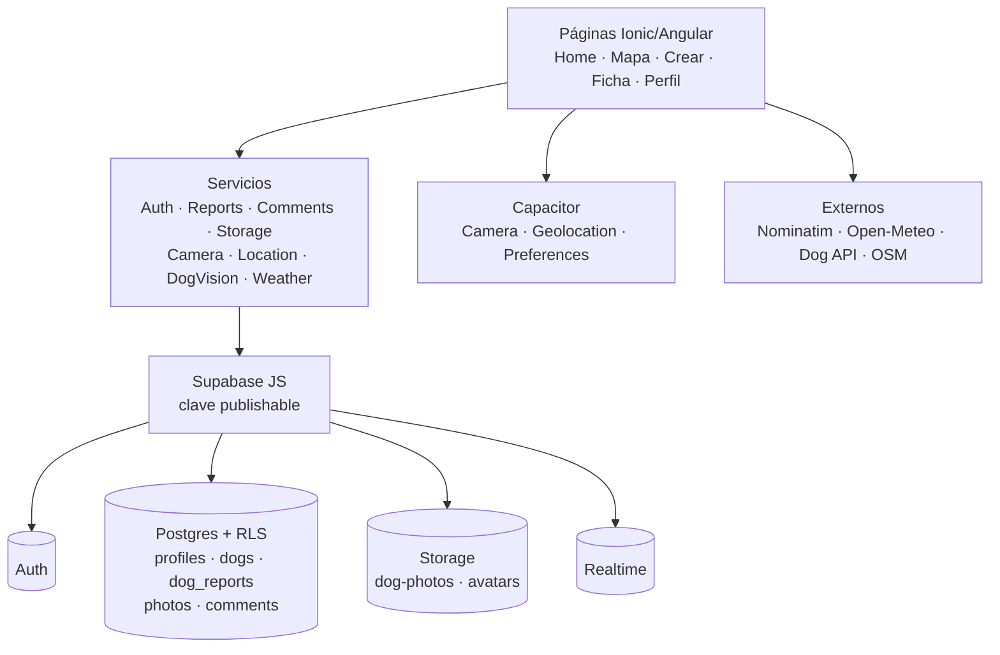

# 🐾 PAWNDER — Resumen rápido para exposición

> Guía de referencia elaborada a partir del código real del repositorio. Para el detalle completo, ver `DOCUMENTACION_TECNICA_Y_EXPOSICION_PAWNDER.md`.
> No incluye claves secretas ni afirmaciones no verificables presentadas como ciertas.

---

## 1. Arquitectura resumida

PAWNDER es una aplicación híbrida (**Ionic + Angular**, empaquetada con **Capacitor** para Android) que usa **Supabase** como backend gestionado: Auth, PostgreSQL con RLS, Storage y Realtime. No hay servidor propio. La IA de sugerencia de raza se ejecuta en el navegador con Transformers.js.

**Idea central:** la identidad del perro es explícita (`dogs` + `dog_reports.dog_id`). El mapa **nunca agrupa por GPS, fotos ni texto**. Los reportes sin `dog_id` quedan como marcadores independientes.

---

## 2. Tecnologías (versiones declaradas en `package.json`)

| Tecnología | Versión | Para qué se usa |
|---|---|---|
| Angular | 22.2.5 | SPA standalone, router y signals |
| Ionic | ^9.0.0 | Componentes de UI móvil |
| Capacitor | 8.6.2 | Puente nativo Android |
| Supabase JS | ^2.119.0 | Auth, PostgREST, Storage, Realtime |
| Leaflet + markercluster | ^1.9.4 / ^1.5.3 | Mapa y agrupación visual |
| Transformers.js | ^4.3.2 | Detección y clasificación en navegador |
| RxJS | ~7.8.0 | Observables (Realtime, paginación) |
| TypeScript | ~6.0.0 | Tipado |
| Vitest | ^5.1.0 | 8 pruebas unitarias |
| Playwright | ^1.64.1 | 1 prueba end-to-end |

---

## 3. Archivos clave

| Archivo | Qué contiene |
|---|---|
| `src/app/app.routes.ts` | Todas las rutas y sus guardas |
| `src/app/core/guards/auth.guard.ts` | `authGuard` y `guestGuard` |
| `src/app/core/services/supabase.service.ts` | Cliente de Supabase con sesión persistente |
| `src/app/core/services/auth.service.ts` | Login, registro, perfil y traducción de errores |
| `src/app/core/services/reports.service.ts` | CRUD de reportes/perros/fotos y canal Realtime |
| `src/app/core/services/comments.service.ts` | Comentarios en árbol y Realtime por reporte |
| `src/app/core/services/camera.service.ts` | Cámara con modal propio y fallback nativo |
| `src/app/core/services/location.service.ts` | GPS puntual y errores de permisos |
| `src/app/core/services/storage.service.ts` | Subida a `dog-photos` y avatares a `avatars` |
| `src/app/core/services/dog-vision.service.ts` | DETR + FastViT + catálogo de razas |
| `src/app/core/utils/report-groups.ts` | `groupReportsByDog()` y `escapeHtml()` |
| `src/app/models/dog-report.model.ts` | Tipos, estados y opciones de formulario |
| `src/app/pages/create-report/create-report.page.ts` | Publicación, perro nuevo/existente y offset de privacidad |
| `src/app/pages/report-detail/report-detail.page.ts` | Estado, comentarios, carrusel y acciones del autor |
| `src/app/shared/components/city-map/city-map.component.ts` | Marcadores, popups y mosaicos OSM |
| `supabase/migrations/20261123_social_features.sql` | Fotos múltiples, hilos y RLS social |
| `supabase/migrations/20261124_dog_identity_and_status.sql` | `dogs`, `dog_id` y trigger de estado |

---

## 4. Funcionalidades en una frase

| Funcionalidad | Explicación breve | Estado |
|---|---|---|
| Registro/login | Supabase Auth; el nombre se guarda en `user_metadata` | Implementado |
| Crear reporte | Foto + GPS + raza + urgencia + clima; `user_id` lo pone el servicio | Implementado |
| Borrador | Se guarda en Capacitor Preferences | Implementado |
| Ubicación aproximada | Desplaza lat/lng con offset aleatorio antes de guardar | Parcial (magnitud del comentario incorrecta) |
| Identidad del perro | perro nuevo o selección de un perro existente | Implementado |
| Listado | Filtros por zona, raza, urgencia y orden | Implementado |
| Mapa | Un marcador por perro; popup con historial | Implementado |
| Estado | `activo` → `en_proceso` → `resuelto`, solo el autor | Implementado |
| Comentarios | Hilos con `parent_id`; Realtime por reporte | Implementado |
| Fotos múltiples | Edición y ficha con carrusel | Parcial en creación |
| Sugerencia de raza | Modelos genéricos + Dog API | Parcial |
| Recuperación de contraseña | — | No implementado |

---

## 5. Quince conceptos técnicos que debes manejar

1. **SPA standalone**: `bootstrapApplication`, sin `NgModule`.
2. **Carga diferida**: `loadComponent` en cada ruta.
3. **Guardas**: `CanActivateFn`; protegen la UI, no sustituyen a RLS.
4. **Signal / computed**: estado reactivo en las páginas.
5. **PostgREST**: consultas encadenadas (`.eq`, `.ilike`, `.order`, `.single`).
6. **Relaciones anidadas**: `profiles(...)`, `dogs(...)`, `dog_report_photos(...)`, `report_comments(count)`.
7. **RLS**: políticas `USING` y `WITH CHECK` por fila.
8. **Políticas restrictivas**: salvaguarda que impide ampliar acceso con otra política permisiva.
9. **Trigger PL/pgSQL**: valida cambio de estado y autoría antes del `UPDATE`.
10. **Realtime**: `postgres_changes` con canales y limpieza al desuscribir.
11. **Storage por carpeta**: ruta `<uid>/<archivo>` y políticas que comprueban `storage.foldername(name)[1]`.
12. **Capacitor plugins**: Camera, Geolocation, Filesystem, Preferences.
13. **Geocodificación inversa**: coordenadas → dirección con Nominatim.
14. **Transformers.js**: inferencia local en navegador con modelos ONNX.
15. **Escape HTML**: `escapeHtml()` antes de interpolar texto del usuario en Leaflet.

---

## 6. Quince preguntas probables del profesor

1. **¿Por qué agrupan por `dog_id` y no por distancia?** Porque dos perros distintos pueden estar en el mismo sitio; la cercanía no demuestra identidad.
2. **¿Qué pasa con los reportes antiguos?** Quedan con `dog_id = NULL`; no hay backfill automático y se muestran separados.
3. **¿Cómo se crea la identidad de un perro?** Con `ReportsService.createDog()`; `created_by` es el usuario autenticado.
4. **¿Quién puede cambiar el estado?** Solo el autor, por UI y por trigger (`42501` si lo intenta otro).
5. **¿Hay administrador?** No; no hay rol ni override en el código.
6. **¿La clave del cliente es secreta?** No; es *publishable*. La seguridad real está en RLS.
7. **¿Qué tablas hay?** `profiles`, `dogs`, `dog_reports`, `dog_report_photos`, `report_comments`.
8. **¿Cuántas migraciones hay y qué hacen?** Dos: social (fotos/hilos/RLS) e identidad+estado (`dogs`, `dog_id`, trigger).
9. **¿Dónde se usa Realtime?** En `home` y `report-detail`; **no** en `map-view`.
10. **¿Cómo se suben las fotos?** A `dog-photos` bajo `<uid>/...`; los avatares van a `avatars`.
11. **¿La IA es un modelo de razas entrenado?** No; es detección y clasificación genérica comparada con un catálogo textual.
12. **¿Funciona sin internet?** Solo si los modelos están en caché; la descarga inicial requiere red.
13. **¿Qué es `is_emergency`?** Un campo de UI; no existe en `dog_reports`. Se traduce a `urgency_level`.
14. **¿Qué pruebas hay?** 8 unitarias (3 archivos) y 1 e2e; build y lint de archivos tocados correctos.
15. **¿Qué no está verificado?** Migración social aplicada, mapeo de fotos, RLS con dos cuentas y comportamiento nativo real.

---

## 7. Resumen de 2 minutos (para decir en voz alta)

"PAWNDER es una app híbrida con Ionic, Angular y Capacitor que usa Supabase como backend. El usuario se registra, toma una foto, obtiene el GPS y publica un aviso con raza, urgencia y clima. La comunidad lo ve en un listado filtrable y en un mapa Leaflet, puede comentar en hilos y coordinar ayuda.

La decisión de diseño más importante es la identidad explícita del perro: existe una tabla `dogs` y cada reporte puede apuntar a un perro con `dog_id`. El mapa agrupa solo por esa clave; si no hay perro asignado, cada aviso es su propio marcador. Así evitamos unir perros distintos solo porque estuvieron cerca o se parecen.

El estado del aviso —activo, en proceso o resuelto— solo lo puede cambiar su autor. La interfaz oculta el control a los demás y un trigger en PostgreSQL rechaza la operación con error de permisos, incluso si alguien intenta llamar a la API directamente. Las guardas de ruta protegen la navegación, pero la autorización real está en las políticas RLS.

Entre las limitaciones están que la creación solo sube una foto, la sugerencia de raza usa modelos genéricos, el mapa no tiene Realtime y falta confirmar en Supabase que la migración social está aplicada y que las fotos se mapean correctamente. Las pruebas actuales son 8 unitarias y 1 end-to-end, todas correctas en la ejecución registrada."

---

## 8. Frases que conviene evitar

| No decir | Decir en su lugar |
|---|---|
| "_el mapa agrupa perros cercanos_" | "el mapa agrupa por `dog_id` explícito" |
| "_la IA reconoce razas con precisión_" | "la IA sugiere una raza comparando etiquetas genéricas con el catálogo" |
| "_el offset es de 30-80 metros_" | "el código aplica un offset aleatorio de `0.003` grados; la cifra del comentario no coincide" |
| "_el perfil se crea al registrar_" | "el registro guarda el nombre en `user_metadata`; la creación de la fila en `profiles` no está versionada" |
| "_todo está terminado y probado en producción_" | "build y pruebas pasan; quedan verificaciones de RLS y migración pendientes" |
